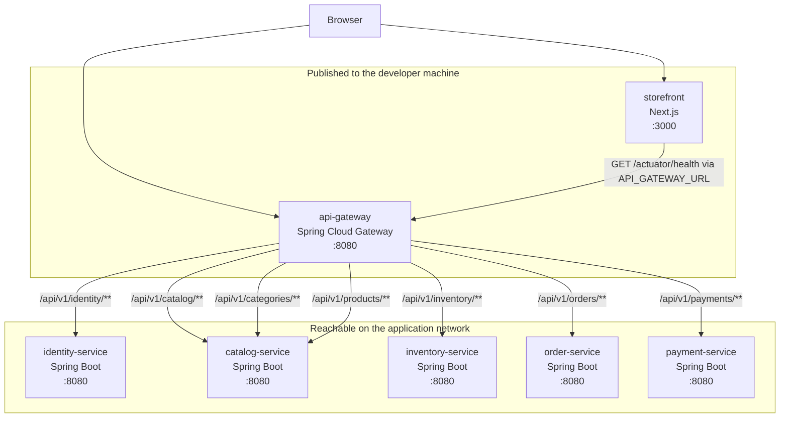

# Container diagram

This is the application path from the browser to each service. Catalog stores products in its own PostgreSQL database. The gateway and the storefront do not.



The ports in the internal tier are container ports. On a laptop, those processes bind 8081 through 8085 so they can run side by side. See [deployment architecture](deployment-architecture.md).

## Routes

| External path | Target |
| --- | --- |
| `/api/v1/identity/**` | `IDENTITY_SERVICE_URL` |
| `/api/v1/catalog/**` | `CATALOG_SERVICE_URL` |
| `/api/v1/categories/**` | `CATALOG_SERVICE_URL` |
| `/api/v1/products/**` | `CATALOG_SERVICE_URL` |
| `/api/v1/inventory/**` | `INVENTORY_SERVICE_URL` |
| `/api/v1/orders/**` | `ORDER_SERVICE_URL` |
| `/api/v1/payments/**` | `PAYMENT_SERVICE_URL` |
| `/actuator/health` on the gateway | Gateway process itself |

Gateway route properties live under `spring.cloud.gateway.server.webflux.routes`.

## Backend layout

Each service uses the same shape:

```text
services/<name>/
├── pom.xml
├── Dockerfile
├── README.md
└── src/
    ├── main/java/com/bazaar/<package>/
    │   ├── <Name>Application.java
    │   └── api/
    ├── main/resources/application.yml
    └── test/java/com/bazaar/<package>/
```

`api` holds the info controller and its response DTO. Gateway routes and CORS live in `application.yml`. A `config` package is added when a service needs Java configuration. Controllers return DTOs. There is no database entity in Phase 1.

The info response for every backend service is:

```json
{
  "service": "identity-service",
  "version": "0.1.0-SNAPSHOT",
  "status": "UP"
}
```

| Service | Info path |
| --- | --- |
| Identity | `GET /api/v1/identity/info` |
| Catalog | `GET /api/v1/catalog/info` |
| Inventory | `GET /api/v1/inventory/info` |
| Order | `GET /api/v1/orders/info` |
| Payment | `GET /api/v1/payments/info` |

Actuator exposes `health`, plus `health/liveness` and `health/readiness`, with details hidden.

## Storefront layout

```text
apps/storefront/
├── package.json
├── package-lock.json
├── README.md
├── Dockerfile
└── src/
    ├── app/
    └── lib/
```

The landing page shows the BAZAAR name, a short product description, and navigation. A same-origin request reports gateway connectivity as loading, success, or error. The server route reads `API_GATEWAY_URL` when it handles the request, so the browser bundle does not contain an environment-specific gateway address.

## Build layout

One Maven Wrapper lives at the repository root, next to a parent POM. A service build from the root looks like this:

```shell
./mvnw -pl services/identity-service -am test
```

The parent holds dependency versions. Each service POM stays buildable on its own through that parent. The storefront builds with `npm ci` and `npm run build` inside `apps/storefront`.
