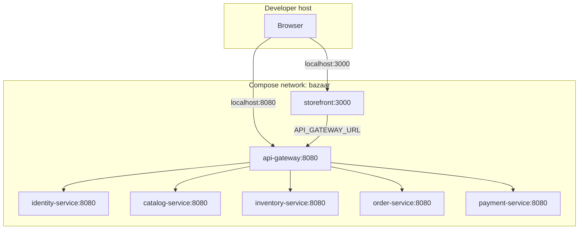
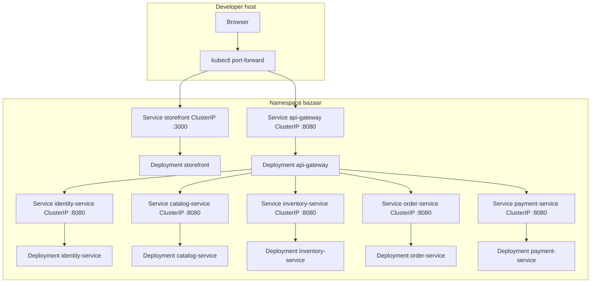
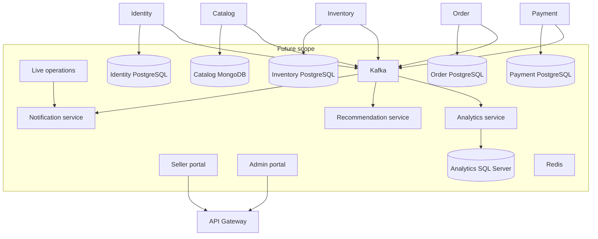

# Deployment architecture

Images are built once and run in Compose, kind, and a future remote Kubernetes cluster. Environment-specific addresses live in Compose environment entries, Kubernetes ConfigMaps, or local `.env` files. They are not baked into images.

## Port model

Every backend process listens on `SERVER_PORT`.

| Place | Backend listen port | How callers reach it |
| --- | --- | --- |
| Local process | Gateway 8080, other services 8081–8085 | `localhost` and that port |
| Container | 8080 for every backend | Compose DNS or Kubernetes Service DNS on port 8080 |
| Storefront | 3000 everywhere | Host port 3000, or `kubectl port-forward` |

Downstream URLs therefore differ by environment:

| Variable | Local processes | Compose and Kubernetes |
| --- | --- | --- |
| `API_GATEWAY_URL` | `http://localhost:8080` | `http://api-gateway:8080` |
| `IDENTITY_SERVICE_URL` | `http://localhost:8081` | `http://identity-service:8080` |
| `CATALOG_SERVICE_URL` | `http://localhost:8082` | `http://catalog-service:8080` |
| `INVENTORY_SERVICE_URL` | `http://localhost:8083` | `http://inventory-service:8080` |
| `ORDER_SERVICE_URL` | `http://localhost:8084` | `http://order-service:8080` |
| `PAYMENT_SERVICE_URL` | `http://localhost:8085` | `http://payment-service:8080` |

`API_GATEWAY_URL` is read by the storefront server at request time. The landing page calls a same-origin route, which then calls the gateway. The image stays usable when the gateway address changes.

The gateway allows browser origins from `CORS_ALLOWED_ORIGINS`. The local default is `http://localhost:3000`.

## Docker Compose

Compose is the local container workflow. It is introduced in M4. It does not define production deployment.

Compose requirements:

- One user-defined network named `bazaar`.
- Published host ports 3000 and 8080–8085.
- `restart: unless-stopped` for local recovery.
- Health checks against gateway and service Actuator readiness, and against the storefront root path.
- The storefront health check does not call the gateway. A gateway failure must not make Compose restart the storefront.
- Multi-stage Dockerfiles, a non-root user, and no build tools in the runtime image.
- No secrets in the image or the Compose file. Phase 1 has no secret values.
- No PostgreSQL, MongoDB, Kafka, or Redis.

Run Compose only while the kind cluster is stopped. Docker Desktop on this machine has about 7.6 GiB for containers.

## Kubernetes

Kubernetes packaging is introduced in M5. The cluster is local kind. The chart must still be installable on another Kubernetes distribution by changing values.

Cluster and chart requirements:

- kind 0.33.0 with one control-plane node and the pinned Kubernetes 1.37.0 node image.
- Commands run in WSL Ubuntu, where kind 0.33.0, Helm 4.3.1, and kubectl 1.37.2 are installed.
- Namespace `bazaar`.
- One Deployment and one ClusterIP Service per application.
- ConfigMap for the URLs above. Secret references only if a later value is sensitive. Phase 1 commits no real credentials.
- Readiness probe: `/actuator/health/readiness` for Java, `/` for the storefront.
- Liveness probe: `/actuator/health/liveness` for Java, `/` for the storefront.
- Startup probe on the Java deployments so a slow JVM start is not treated as a deadlock.
- CPU and memory requests and limits. Starting point: Java requests `100m` / `256Mi` and limits `500m` / `512Mi`; storefront requests `50m` / `128Mi` and limits `300m` / `384Mi`.
- Java heap stays inside the limit with `MaxRAMPercentage`.
- `terminationGracePeriodSeconds` aligned with Spring `server.shutdown=graceful`.
- Rolling update with a configurable image repository and tag.
- Local kind uses `IfNotPresent` after `kind load docker-image`. A remote cluster uses a GHCR repository and `IfNotPresent` or `Always` through values.
- Host access is `kubectl port-forward` to the storefront and the gateway. Phase 1 does not install an ingress controller.
- No hostPath, node IP, or laptop path in the manifests.

Image names:

| Application | Local image |
| --- | --- |
| API Gateway | `bazaar-api-gateway` |
| Identity | `bazaar-identity-service` |
| Catalog | `bazaar-catalog-service` |
| Inventory | `bazaar-inventory-service` |
| Order | `bazaar-order-service` |
| Payment | `bazaar-payment-service` |
| Storefront | `bazaar-storefront` |

Remote names follow `ghcr.io/<owner>/bazaar-<application>:<tag>`. The owner and tag are Helm values.

## Logging and shutdown

Java services set `logging.structured.format.console` to `ecs`. Each line includes the timestamp, level, service, and message. Health details stay hidden.

`server.shutdown=graceful` lets in-flight requests finish before the process exits. Kubernetes uses the same idea through the termination grace period and the default preStop behavior of removing the pod from the Service before the process stops.

## Future target architecture

The diagram below is **future scope**. None of these datastores, brokers, or extra applications are part of Phase 1, and Phase 1 must not add them.

When that work starts, each database belongs to one service ([ADR-005](../adr/ADR-005-database-ownership.md)). Events use an envelope with `eventId`, `eventType`, `aggregateId`, `aggregateVersion`, `occurredAt`, `schemaVersion`, `correlationId`, `causationId`, and `payload`. Delivery is at least once, with idempotent consumers, retries, and a dead-letter path. The outbox and Saga replace the synchronous checkout coordination. WebSocket stays on the notification edge.

Managed databases outside the application cluster are the preferred production option. Phase 1 does not provision them.
