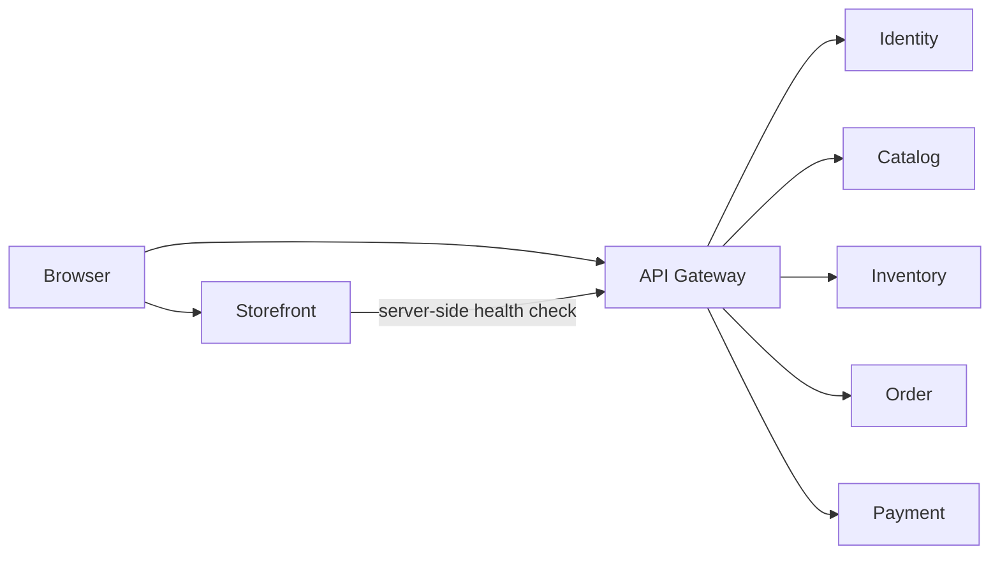

# Architecture overview

BAZAAR Phase 1 is a deployable skeleton for a multi-vendor marketplace. The skeleton proves that each application can be built, tested, packaged, and run on a laptop, in Docker Compose, and on a local Kubernetes cluster. It also keeps the image and configuration model portable to a later remote Kubernetes cluster.

## Scope of Phase 1

Phase 1 includes:

- One Next.js storefront with a landing page and a gateway connectivity check.
- One Spring Cloud Gateway as the single HTTP entry point for backend APIs.
- Five Spring Boot services: identity, catalog, inventory, order, and payment.
- Health endpoints, one informational REST endpoint per backend service, and tests.
- Environment-based configuration, structured logs, and graceful shutdown.
- Multi-stage container images, Docker Compose, a single-node kind cluster, and a Helm chart.
- GitHub Actions for build, test, image build, and GHCR publishing rules.

Phase 1 left these for later work:

- Registration, login, JWT, and refresh tokens.
- Product, cart, checkout, inventory, and payment behavior.
- Databases, Kafka, Redis, Saga, and the transactional outbox.
- WebSocket, notifications, recommendations, analytics, and extra frontends.
- Ingress, TLS, DNS, Terraform, and any cloud cluster.

## Phase 2

Phase 2 delivers the customer purchase path on one PostgreSQL server and Keycloak. Each business service still has its own database. Checkout is synchronous REST: the order service reads the catalog price, reserves stock, stores the order, and simulates payment. Success commits the reservation. Failure releases it. The storefront keeps the cart in the browser and the access token in an HTTP-only cookie.

Phase 3 adds one local KRaft broker and one local Redis. Checkout accepts the order, then the order service drives inventory and payment with commands. Each step is stored on the order and can be resumed after a restart. Consumers ignore a repeated `eventId`. The catalog can answer a public product or category read from Redis, and drops that entry when the product event is consumed. Checkout still reads the product price from the catalog database. The gateway counts requests in Redis and keeps serving if Redis is down. A real payment provider, WebSocket, and the extra frontends are still later. The kind chart does not run Postgres, Keycloak, Kafka, or Redis.

## Principles

1. The repository is a monorepo. Each service still builds and deploys on its own.
2. A service owns its code, configuration, tests, Dockerfile, and README.
3. Services talk over HTTP through the gateway or, for the gateway itself, to a configured downstream URL. No service reads another service's data store.
4. Configuration comes from environment variables. Images contain no environment-specific addresses and no secrets.
5. Compose is the local container workflow. Helm is the Kubernetes workflow. Compose is not the production deployment format.
6. Delivery is at least once once events exist. Consumers must be idempotent. Phase 1 does not use a broker.
7. Important decisions are recorded as ADRs.

## Runtime shape

The storefront page calls a same-origin route. That route reads `API_GATEWAY_URL` on the server and calls the gateway health endpoint. The browser can also call the gateway directly during development, which is why the gateway has CORS. Details are in [deployment architecture](deployment-architecture.md) and [ADR-004](../adr/ADR-004-docker-and-kubernetes.md).

## Version baseline

These versions were chosen in M0 because they are installed or are the current stable releases that work together. M2 pinned Java 25, Spring Boot 4.1.2, Spring Cloud 2025.1.4, and Maven 3.10.0. M3 pinned Next.js 16.4.5 and React 19.3.0 in the storefront lockfile.

| Choice | Version | Reason |
| --- | --- | --- |
| Host JDK | Oracle Java 25.0.5.0.3 at `C:\Program Files\Java\jdk-25.0.5.0.3` | Installed LTS JDK. Spring Boot 4.1 supports it. |
| Container JDK | Eclipse Temurin 25 JRE | Redistributable runtime for images. The host Oracle JDK is not copied into images. |
| Spring Boot | 4.1.2 | Current open-source line. Requires Java 17 through 27. |
| Spring Cloud | 2025.1.4 | Supports Spring Boot 4.1.2. Gateway module 5.0.4. |
| Gateway starter | `spring-cloud-starter-gateway-server-webflux` | Current Gateway artifact. Routes use `spring.cloud.gateway.server.webflux`. |
| Maven | 3.10.0 through Maven Wrapper | Current stable Maven. Boot requires 3.6.3 or newer. A system Maven is not required. |
| Node.js | 24.22.1 with npm 11.19.1 | Installed. Next.js 16 requires Node.js 20.9 or newer. |
| Next.js | 16.4.5 | Current stable 16.x release, including the November 2026 security fixes. React 19.3.0. |
| kind node | `kindest/node:v1.37.0@sha256:a1ed56cfb0e7b93589bdf97c8cd566405a265939e3620fc4f5de89adff580ae5` | Default image for the installed kind 0.33.0. |
| Helm | 4.3.1 in WSL | Supports Kubernetes 1.37 through 1.34. |
| kubectl | 1.37.2 in WSL | Matches the kind node minor version. |

Spring Boot 3.5 and Spring Cloud 2025.0 are out of open-source support, so they are not the baseline.

## Module and package names

The Maven parent is `com.bazaar:bazaar:0.1.0-SNAPSHOT`. Each service is its own module and can be built from the repository root.

| Service | Maven artifact | Base package |
| --- | --- | --- |
| API Gateway | `api-gateway` | `com.bazaar.gateway` |
| Identity | `identity-service` | `com.bazaar.identity` |
| Catalog | `catalog-service` | `com.bazaar.catalog` |
| Inventory | `inventory-service` | `com.bazaar.inventory` |
| Order | `order-service` | `com.bazaar.order` |
| Payment | `payment-service` | `com.bazaar.payment` |

Phase 1 packages stay small: application class, web API, and configuration. Persistence and domain packages appear when a service owns behavior and data.

## Related documents

- [System context](system-context.md)
- [Container diagram](container-diagram.md)
- [Service responsibilities](service-responsibilities.md)
- [Deployment architecture](deployment-architecture.md)
