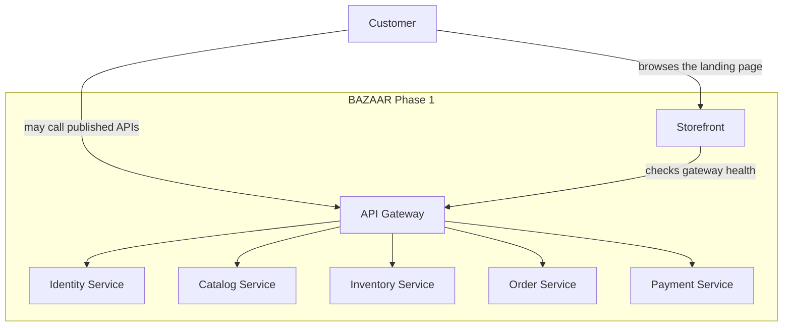

# System context

Phase 1 has one human actor and one software system. The system is made of a storefront and six backend processes. Those processes are inside the BAZAAR boundary. The customer reaches them through a browser.

## Actors

| Actor | Relationship in Phase 1 |
| --- | --- |
| Customer | Opens the storefront and can call the gateway health and info routes. |
| Developer | Builds and runs the skeleton locally, in Compose, or on kind. |
| GitHub Actions | Builds, tests, and publishes images to GHCR on trusted branches. |

Seller, administrator, and operations users are later actors. They have no application in Phase 1.

## External systems

Phase 1 integrates with no payment provider, identity provider, database, or message broker. GHCR is the only planned external system, and it is used by CI to store images. A developer can run the whole skeleton without GHCR by building and loading images locally.

## Boundary rules

- The browser talks to the storefront for the page, and to the gateway only when an API is called directly.
- Backend services are reached through the gateway. A service does not call another service in Phase 1.
- The storefront server may call the gateway health endpoint. It does not contain business rules.
- The gateway routes and applies CORS. It does not contain marketplace rules.
