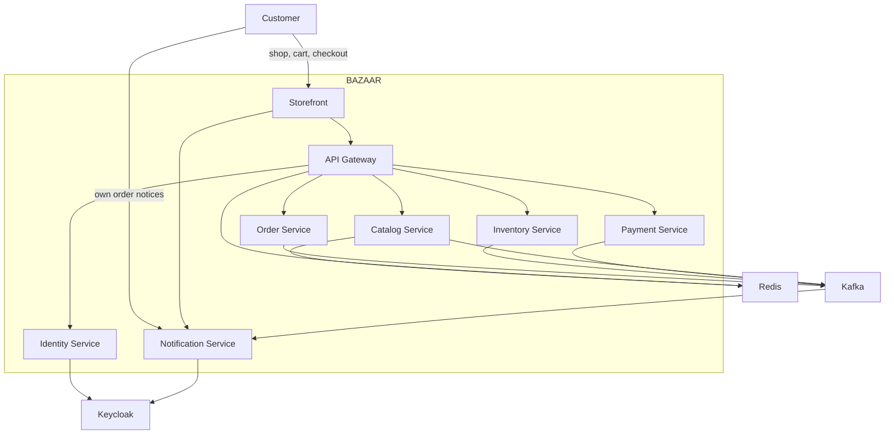

# System context

The customer reaches BAZAAR through the storefront. The storefront calls the gateway. The notification socket is the one backend connection the browser opens directly.

## Actors

| Actor | Relationship |
| --- | --- |
| Customer | Browses, checks out, and receives only their own order notices. |
| Seller | Publishes products. The seller application is still the same storefront and API. |
| Developer | Builds and runs the stack locally in Compose, or the application chart on kind. |
| GitHub Actions | Builds, tests, and publishes images to GHCR on trusted branches. |

Administrator and operations consoles are later applications. They have no separate frontend.

## External systems

Keycloak issues tokens. PostgreSQL holds one database per service. Kafka carries events and commands. Redis caches public catalog reads, counts gateway requests, and can fan socket events out. There is no card network. GHCR stores images from CI. A developer can run Compose without GHCR by building the images locally.

## Boundary rules

- The browser talks to the storefront for pages and to the notification service for the socket. It does not talk to Kafka.
- Business HTTP calls go through the gateway. The order service calls the catalog over HTTP for the checkout price. Inventory and payment are driven by commands, not by that checkout request.
- The storefront keeps the access token in an HTTP-only cookie and attaches it when it calls the gateway or the notification service.
- The gateway routes, applies CORS, and limits request rate. It does not decide whether a token may call a service.
